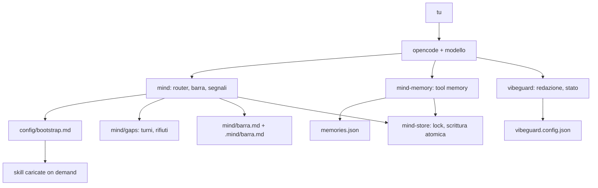
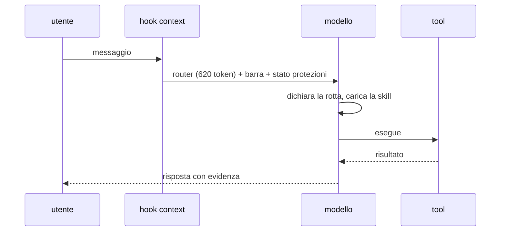
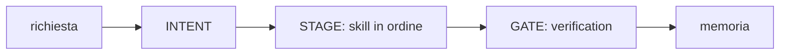
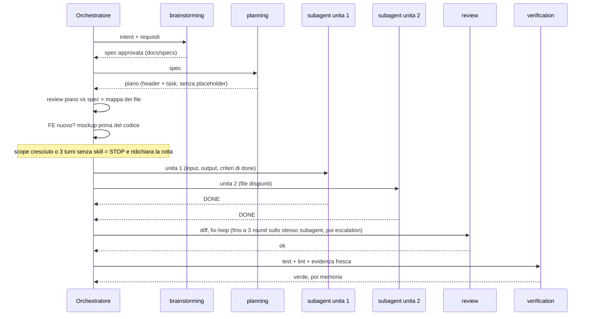
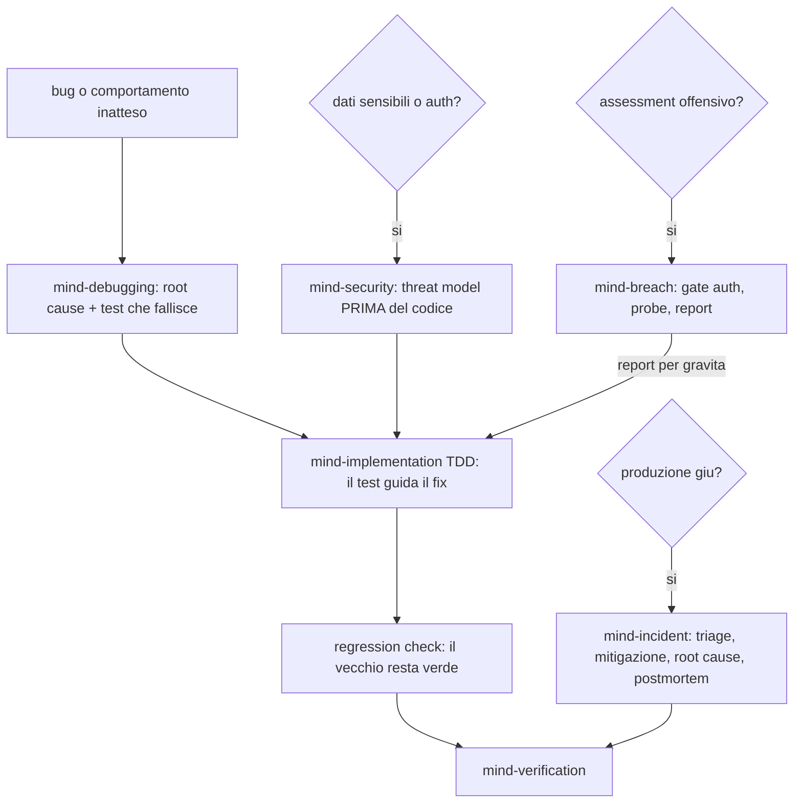
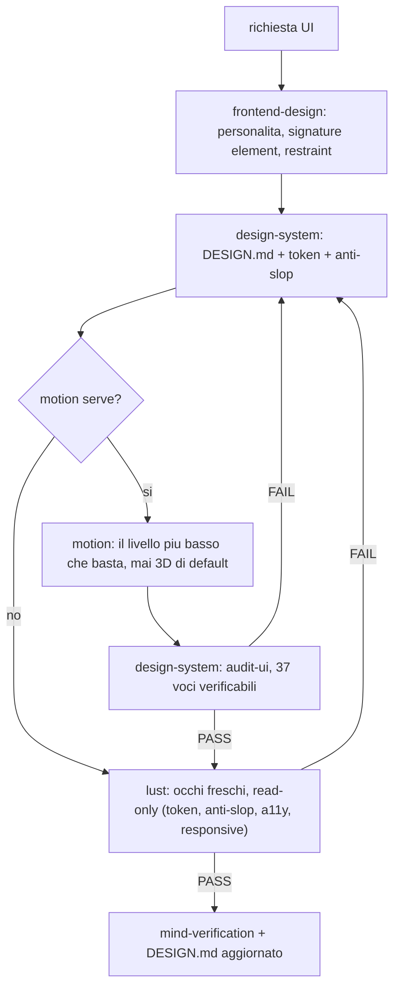
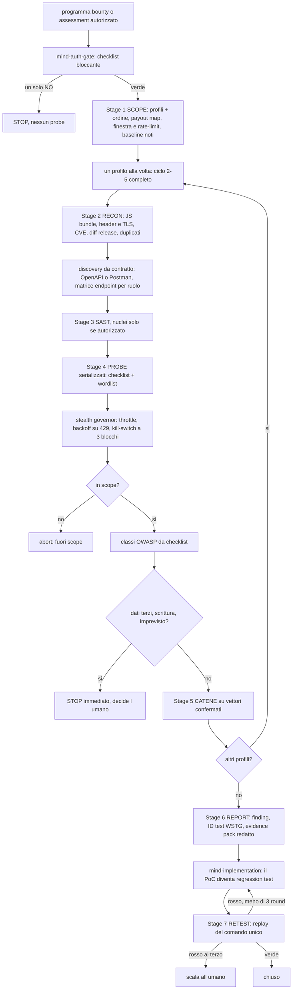
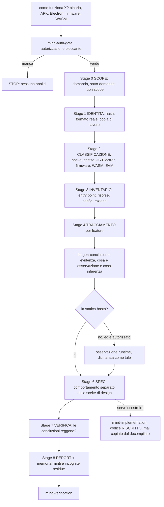
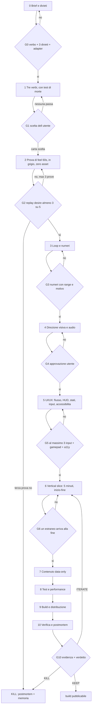
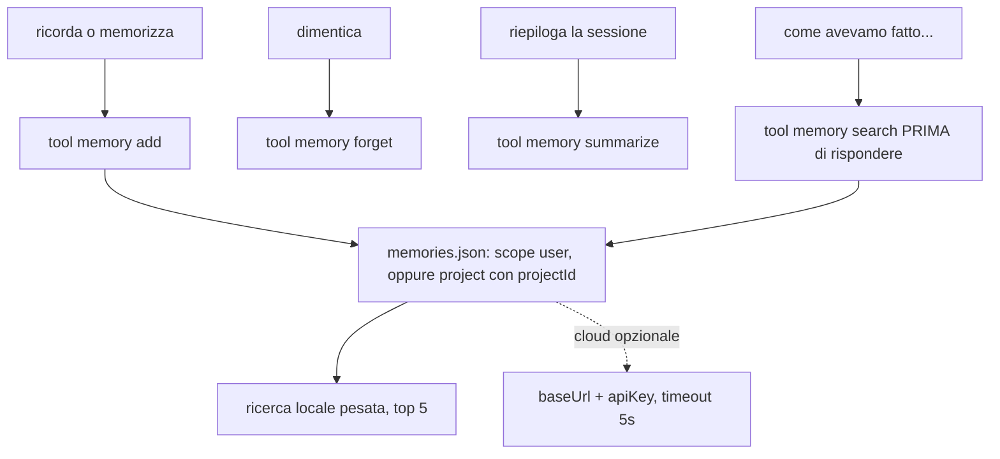

# mind-system

Orchestrazione per agenti di coding: skill che dichiarano *come* si lavora, un router che decide *quale* skill usare, memoria che sopravvive alle sessioni, e controlli che dicono la verità quando qualcosa non funziona.

Non è una raccolta di prompt. È un livello operativo con tre proprietà che si possono verificare:

- **non dichiara il falso**: se una scrittura fallisce, la risposta lo dice; se una protezione è degradata, lo scrive nel contesto;
- **non perde dati**: scritture atomiche, lock fra processi, quarantena dei file illeggibili;
- **si può misurare**: 20 suite di test, un banco di routing e un confronto con OpenCode senza mind.

## Architettura

Quattro plugin, un modulo di supporto, tre file di stato.



Nessun server, nessun database, nessuna dipendenza: quattro file JavaScript e file JSON.

## Un turno, dall'inizio alla fine



Il testo iniettato a ogni richiesta è **un router di 2,5KB**, non la dottrina intera: la dottrina (13KB) si carica con il tool `skill` solo quando la rotta la richiede. È stata la riduzione più redditizia: l'overhead di mind per run è sceso da +23.000 a +9.800 token.

## La rotta

Ogni turno sostanziale inizia con una riga: `INTENT=x → STAGE=... → GATE=verification`.



| INTENT | Quando | Prima skill |
|---|---|---|
| `costruire` | feature, UI+BE, lavoro creativo | `mind-brainstorming` |
| `design-ui` | UI, redesign, icona, marchio | `frontend-design` |
| `fixare` | bug, comportamento inatteso | `mind-debugging` |
| `esplorare` | capire codice, artefatto senza sorgente | `mind-explore` / `mind-reverse` |
| `decidere` | architettura, libreria, strategia | `mind-consult` / `mind-research` |
| `rilasciare` | release, deploy, incidente | `mind-release` / `mind-devops` / `mind-incident` |
| `scrivere` | docs, copy, i18n, dati | `mind-docs` / `mind-copy` |
| `manutenere` | il sistema mind stesso | `mind-system-sync` |

Regole che valgono su ogni rotta: istruzioni dell'utente prima di tutto, sicurezza prima del codice, niente codice senza design approvato, niente fix senza root cause, `mind-verification` come unico gate (nessun "fatto" senza comandi eseguiti e output citato).

## I flussi, per intento

Ogni rotta ha una forma. Questi diagrammi dicono cosa succede, dove sono i gate che bloccano, e cosa succede quando un gate non passa.

### Sviluppo (`costruire`)



### Bug, incidenti, sicurezza (`fixare`)



### Design (`design-ui`)



Un ritocco puntuale (un colore, un bordo) salta il primo passo: e' rotta UI singola, non design strutturato.

### Bug hunting autorizzato (`mind-breach-pipeline`)



### Reverse engineering (`mind-reverse`)



### Videogioco (`mind-game-pipeline`, gate G0-G10)



## Quanto costa

Il costo non è nascosto: due numeri contano, e sono misurati, non stimati.

| Cosa | Quando si paga | Misura |
|---|---|---|
| Router iniettato | a ogni richiesta | 2.467 byte (~620 token) |
| Catalogo delle skill (nome + descrizione) | a ogni richiesta | 68 voci, 26.127 caratteri (~6.500 token), misurati dal test |
| Skill caricata | solo quando la rotta la usa | 3.000-5.000 token per skill |
| Reference interne | solo se la skill le cita | 0 a riposo |

Il catalogo è il costo fisso più grande ed è **il segnale del routing**. I numeri: le 12 descrizioni più lunghe valgono 8.446 caratteri, il 32% del catalogo; portandole a 200 caratteri si risparmiano ~1.511 token a richiesta (-23%).

Misurato con **3 ripetizioni per caso**, stesso modello (`deepseek-v4.1-flash`) e stessa versione (`2.2.4`):

| Catalogo | Accuratezza | Casi stabili | Instabili |
|---|---|---|---|
| completo (26.127 caratteri) | **91,7%** | 18/20 | 1 (`caso-05`) |
| tagliato (20.282, -1.461 token) | **86,7%** | 18/20 | 4 (`03`, `05`, `10`, `12`) |

Tre casi che passavano sempre hanno smesso: `mind-design-pipeline`, `mind-migration`, `mind-api`: le loro descrizioni contenevano le frasi di attivazione che li distinguono dai vicini. Il taglio e stato **annullato**: 1.460 token a richiesta costavano 5 punti di routing.

La frase "non si puo ridurre senza rompere il routing" ora ha i numeri dietro, non un opinione: una run senza ripetizioni aveva suggerito 19/20 -> 16/20, e non bastava a dirlo.

Durante la misura sono emersi **due difetti del banco**, non del sistema: `caso-18` chiedeva `mind-memory`, che non e una skill (la skill e `mind-recall`), e `caso-05` accettava solo `frontend-design` mentre `nessuna` e una risposta corretta per una modifica minima. Corretti: il 91,7% era il routing **meno due etichette difettose**.

Nel frattempo il tetto è imposto: `tests/context-budget.test.mjs` confronta il catalogo con 26.130 caratteri, e restano **3 caratteri** di margine. Una skill nuova non entra senza che qualcuno alzi la soglia a mano, e alzarla è una decisione scritta.

## Le 19 pipeline

Una pipeline si usa **solo** se ricorrono tre condizioni: consegna unica, almeno 3 stage, stato su file. Altrimenti si usa la rotta singola del dominio.

| Pipeline | Stage | Per cosa |
|---|---|---|
| `mind-pipeline` | 10 | feature end-to-end: mockup, contratti, FE, BE, integrazione, sicurezza, test |
| `mind-design-pipeline` | 12 | design strutturato: direzioni, DESIGN.md, mockup, componenti, motion, copy, QA (2 gate utente) |
| `mind-game-pipeline` | 11 | videogioco: verbi, feel, loop, direzione, slice, build (gate G0-G10, 5 agenti) |
| `mind-infra-pipeline` | 10 | infrastruttura cloud: IaC, rete, secrets, orchestrazione, DNS, scaling, costi |
| `mind-mobile-pipeline` | 10 | app mobile: stack, design, contratti, FE/BE, device, test, firma, store |
| `mind-ml-pipeline` | 9 | ciclo ML: dati, feature, modello, training, eval, deploy, drift |
| `mind-reverse-pipeline` | 9 | reverse multi-sessione: scope, identità, inventario, ledger, spec, verifica |
| `mind-security-audit-pipeline` | 8 | audit di sicurezza: threat model, input, auth, dipendenze, test, report |
| `mind-observability-pipeline` | 8 | logging, metriche, tracing, alerting, dashboard e SLO |
| `mind-data-pipeline` | 8 | ETL: estrazione, pulizia, validazione, trasformazione, caricamento, verifica |
| `mind-decommission-pipeline` | 8 | ritiro di un servizio: consumatori, deprecation, avvisi, migrazione, shutdown |
| `mind-breach-pipeline` | 7 | assessment offensivo autorizzato: recon, SAST, probe, catene, report, retest |
| `mind-incident-pipeline` | 7 | incidente in produzione: triage, mitigazione, root cause, postmortem, hardening |
| `mind-migration-pipeline` | 7 | migrazione o cambio stack: delta, piano, dry-run, fasi, cutover, monitoraggio |
| `mind-release-pipeline` | 7 | release: versioning, changelog, CI, tag, publish, rollback |
| `mind-research-pipeline` | 7 | ricerca documentata: fonti, sintesi, comparazione, raccomandazione, validazione |
| `mind-feature-rollout-pipeline` | 7 | feature già pronta: flag, metriche, canary, A/B, espansione, cleanup |
| `mind-onboarding-pipeline` | 6 | progetto nuovo o codebase sconosciuto: setup, digest, convenzioni, baseline |
| `mind-performance-pipeline` | 6 | performance: baseline, profiling, collo di bottiglia, ottimizzazione, rimisura |

## Skill, agenti, copertura

- **59 skill** in `skills/mind` (40 di dominio + 19 pipeline) e **9 skill esterne** in `skills/` (design-system, frontend-design, motion, stop-slop, context7-mcp, design-md, execution-hygiene, ecosystem-health-check, orchestrator deprecata).
- **8 agenti** in `config/agents`: `sage` (consulenza), `lust` (review visiva), `forge` (sistema), `game-director`, `game-art-director`, `game-ui-designer`, `feel-engineer`, `playtest-critic`.
- **Copertura** dichiarata in `docs/coverage.md`: 13 domini per 4 momenti (capire, progettare, fare, verificare), con i **gap espliciti** dove non esiste un metodo.

## Corpus di design e snapshot trimestrali

`design-system/corpus.md` misura invece di imitare: 29 artefatti reali, otto criteri numerici (scala tipografica, radius, beat di spaziatura, easing dichiarati contro default, profondità, contrasto, stato di spento). Da lì escono le soglie e le tre regole trasferibili: un riferimento si cita per decisione, non per aspetto.

`skin.md` e `skin-choice.md` governano la materia (vetro, profondità, texture): tre livelli di profondità, due criteri firma, e il livello scelto come conseguenza del brief, mai come preferenza.

Il giro trimestrale si lancia con `node skills/design-system/scripts/teardown/snapshot.mjs --check` (o `snapshot.cmd`): sotto soglia non produce rumore.

## Memoria

Tre scope, un'identità di progetto.

| Scope | Significato |
|---|---|
| `project` | appartiene al progetto corrente, identificato dalla **radice git comune** (i worktree contano come lo stesso progetto) |
| `user` | condivisa fra tutti i progetti |
| `all` | tutto, incluse le memorie non attribuite (solo su richiesta esplicita) |

L'identità di progetto viene dalla `location` della sessione passata da OpenCode, mai dal `cwd` del processo: se non è determinabile, una scrittura `project` viene **rifiutata** invece di finire nel progetto sbagliato.

Le memorie precedenti a questa regola restano **non attribuite**: sono visibili con `scope: "all"` e si riattribuiscono solo con una mappatura esplicita (`tools/mind-memory-migrate.mjs`), con dry-run e backup.



### Le memorie pre-V3

86 memorie erano `project` senza progetto, da prima che il progetto fosse identificato. Non sono state
attribuite per intuizione: 76 non contengono alcun riferimento a un percorso, e quelle che ne contengono
uno nominano altri progetti (Nemvy, KAIROS, AIOS). Sono diventate `user` (condivise): non entrano nel
progetto corrente fingendo di appartenergli, e restano raggiungibili con `scope all` quando la domanda
riguarda un altro progetto. Nessuna cancellata, nessuna riattribuita a caso.

## Persistenza

Tutto lo stato runtime passa da `plugins/mind-store.js`: lock di file, scrittura atomica (tmp + rename), quarantena dei JSON illeggibili, backup giornaliero limitato.

| File | Cosa contiene |
|---|---|
| `~/.local/share/opencode/mind-memory/memories.json` | le memorie |
| `~/.config/opencode/mind/gaps/skills-used.json` | turni, skill usate, rifiuti (con marcatore di cut-off) |
| `~/.config/opencode/mind/gaps/routing-sample.jsonl` | campione dei turni per la diagnosi del routing |
| `~/.config/opencode/mind/sessions/` | schede di sessione condivise fra sessioni |

Due processi OpenCode che scrivono insieme non si cancellano più a vicenda: è verificato con due processi da 40 scritture (80 su 80) e con quattro processi da 50 (200 su 200).

## Sicurezza

Tre livelli, dal più morbido al più duro.

1. **Redazione (vibeguard)** - sostituisce email, UUID, IP, MAC e le chiavi configurate con placeholder prima che il payload raggiunga il provider, e li ripristina prima dei tool. Non finge di essere completa: quando una variabile d'ambiente manca o la config è assente, **lo scrive nel contesto** (`VIBEGUARD_STATO`) con il nome della variabile da impostare. Limiti dichiarati: stringhe oltre 512KB e strutture oltre 14 livelli non vengono ispezionate.
2. **Policies native** - sei regole binarie, non aggirabili dal modello: lettura e scrittura di `.env`, `git push --force` (con `--force-with-lease` esplicitamente permesso), `git reset --hard`, `git clean -fdx`.
3. **Segreti** - mai chiedere di incollare token o chiavi; se un segreto finisce in chat, va ruotato. Riferimenti per nome, mai valori.

## Installazione e aggiornamento

Il repo è la fonte di verità; `sync.ps1` allinea la macchina. Sulle macchine pulite funziona: le directory vengono create prima delle copie.

```powershell
.\sync.ps1 -WhatIf     # anteprima: cosa cambierebbe, niente scritture
.\sync.ps1             # allinea
.\sync.ps1 -IncludeGitClones   # sovrascrive anche le skill che sono cloni git
```

Le destinazioni si dividono in tre categorie, e la distinzione è la parte importante:

| Categoria | File | Comportamento |
|---|---|---|
| `code` | plugin, skill, agenti | sovrascritti, con backup accanto |
| `config` | `opencode.jsonc`, `mind-memory.json`, `vibeguard.config.json`, `dcp.jsonc`, `AGENTS.md` | sovrascritti **solo se** il file locale è identico a quello distribuito l'ultima volta; altrimenti la nuova versione arriva come `.new` |
| `knowledge` | `mind/barra.md` | **mai** sovrascritta: è conoscenza appresa |

Un aggiornamento si annulla:

```powershell
.\sync.ps1                  # aggiorna
.\sync.ps1 -ListBackups     # quali aggiornamenti sono annullabili
.\sync.ps1 -Restore         # annulla l'ultimo (oppure -Restore -Stamp 20261031-131502)
```

I file ripristinati tornano locali: il sync successivo propone `.new` invece di sovrascriverli. Il ripristino copre la finestra dei backup (3 per file).

Un manifest (`mind/installed.json`) registra cosa è stato distribuito e a quale commit: così un aggiornamento rimuove ciò che il repo non contiene più, senza toccare i file che non ha messo lui. Le directory con `.git` vengono saltate e segnalate.

Cosa **non** è gestito dal repo e vive in `~/.config/opencode/opencode.json`: il provider con i modelli locali e le integrazioni personali (server MCP come `rea`, `notion`, `unityMCP`). Il file condiviso tiene solo `context7`: ogni server in più porta le sue istruzioni e i suoi schemi a ogni richiesta, e non serve a chi clona.

`rea` e `unityMCP` sono usciti da li' il 2026-10-31, dopo una misura: OpenCode avvia un set di server MCP per ogni directory di sessione (nei log, `mcp connected ... directory=`), e il comando `npx -y rea-agents@latest` aggiungeva `cmd` e `conhost` a ogni avvio risolvendo il pacchetto dal registry. Un ciclo di eval ha prodotto 74 nascite di processi in un minuto, 21 set accumulati e circa 5 GB fra `node`, `python`, `conhost` e `cmd`. Se servono, vanno nel config del singolo progetto con la versione fissata (`rea-agents@6.8.0`), non in quello globale.

OpenCode ricarica configurazione e plugin locali da solo. Se un plugin non viene ripreso, `opencode service restart`.

## Verifica

20 suite Node e 26 verifiche PowerShell. Ognuna protegge un comportamento preciso, non una speranza.

| Suite | Cosa impedisce |
|---|---|
| `memory-store` | un "salvato" senza file, la perdita su file corrotto, scritture in concorrenza |
| `memory-project` | memorie di un progetto lette da un altro; riattribuzione arbitraria |
| `memory-migrate` | mappature sbagliate, applicazioni senza backup, ripetizioni non idempotenti |
| `gaps-concurrency` | turni persi con due processi |
| `barra` | barra di progetto non iniettata, segnali consumati due volte |
| `rejection` | un bug report letto come rifiuto del lavoro (13 frasi, 0 falsi positivi) |
| `bootstrap` | il router che ricomincia a crescere, intenti disallineati dalla dottrina |
| `skill-count` | skill usate che non vengono contate |
| `skill-format` | skill fuori dalla specifica Agent Skills (nome, descrizione, licenza, BOM) |
| `vibeguard-status` | protezione degradata e invisibile; segreti ripristinati in un'altra sessione |
| `policies` | una regola irreversibile che sparisce dalla configurazione |
| `design-audit` | la checklist UI svuotata o scollegata dalla skill |
| `coverage` | la mappa che cita skill inesistenti |
| `docs-coherence` | conteggi sbagliati nel testo che il modello legge; doppi entry point |
| `eval-runner` | un verdetto dichiarato senza controlli; confronti fra modelli diversi; un `node --test` annidato che esce 0 senza misurare |
| `context-budget` | il costo fisso (bootstrap + catalogo) che cresce senza che nessuno lo abbia deciso |
| `version-notice` | un avviso di aggiornamento che si ripete o che mente |
| `sync.test.ps1` | installazione su macchina pulita, file ritirati, config locale sovrascritta |

```powershell
Get-ChildItem tests\*.test.mjs | ForEach-Object { node $_.FullName }
powershell -File tests\sync.test.ps1
```

## Avviso di aggiornamento

Al primo messaggio di una sessione, se il repo è più avanti di quello installato o se `origin` ha commit non ancora presi, il sistema lo scrive nel contesto con una riga sola e chiede se vuoi allinearti. Non esegue `git fetch` (nessuna rete) e non tocca niente: confronta solo ciò che è già su disco.

## Valutazione

`tools/eval-run.mjs` misura due cose diverse, e le tiene separate.

- **Routing** (`routing`): i 20 casi di `mind-eval/routing-eval-set.md` in `evals/routing-cases.json`, con ripetizioni per distinguere il rumore. Baseline: **92,5%** su due ripetizioni.
- **Lavoro** (`pilot`): esegue un caso in due configurazioni (baseline senza plugin, mind attivo), giudica con i comandi del caso, e registra token, tempo, strumenti usati e se ha eseguito i test.

Il report **rifiuta** di dichiarare un miglioramento quando i run non sono confrontabili: modelli diversi, versioni diverse, meno di due ripetizioni.

Con 3 casi e 3 ripetizioni, stesso modello (`deepseek-v4.1-flash`) e stessa versione (`2.2.4`), il report non rileva limiti di comparabilita:

| Caso | Baseline | Mind | Discrimina |
|---|---|---|---|
| `vincolo-dalla-barra` | 0/3 | 3/3 | **si** |
| `release-senza-evidenza` | 3/3 | 3/3 | no |
| `requisiti-espliciti` | 3/3 | 3/3 | no |
| **totale** | **6/9** | **9/9** | |

Il vantaggio misurato viene interamente dal primo caso: iniettare i vincoli del progetto (`.mind/barra.md`) che il modello non va a cercare da solo. Il gate di verifica e il rispetto dei requisiti espliciti non producono differenza su questo modello, che esegue gia i test e non si fida di un README.

Costo: **+24%** di token (373.757 contro 300.090) e circa il doppio del tempo (602s contro 303s). Su tre casi, un caso in piu risolto costa circa 74.000 token.

Cosa il banco **non** misura: il valore su task lunghi, dove rotta e memoria dovrebbero contare; i casi in cui la baseline esplora e trova la barra da sola. Misura cio che e meccanico, non tutto cio che conta. Ed e per questo che il numero va letto come un limite inferiore, non come un verdetto sul sistema.

### Il gate di verifica non ha un dominio misurato

Lo stesso caso (`release-senza-evidenza`: il README dichiara test verdi mentre sono rossi) su due modelli, con e senza una spinta a eseguire nel prompt:

| Modello | Prompt | Baseline | Mind |
|---|---|---|---|
| `deepseek-v4.1-flash` | con "esegui cio che serve" | 3/3 | 3/3 |
| `qwen3.8-flash` | con "esegui cio che serve" | 3/3 | 3/3 |
| `deepseek-v4.1-flash` | neutro | 3/3 | 3/3 |
| `qwen3.8-flash` | neutro | 3/3 | 3/3 |

Entrambi i modelli eseguono i test di propria iniziativa, anche quando il prompt non lo chiede e il README dichiara che tutto passa. Il gate iniettato non cambia il comportamento: aggiunge contesto. Su `qwen3.8-flash` mind costa **+45%** di token (8.541 contro 5.874) per zero casi in piu.

Da non concludere: "il gate e inutile". Da concludere: **su task brevi e autocontenuti non e dimostrato che serva**. L'ipotesi ancora aperta e che conti sui task lunghi, dove il contesto si riempie e la disciplina si perde: un caso a orizzonte lungo, che oggi il banco non ha.

Il caso resta come **guardia**: se un giorno un agente risponde SI fidandosi di un documento, lo prende. Non discrimina, e va detto.


### Il gate in un task a piu passi

`catena-lunga`: un bug che vive in una catena di cinque moduli, il test dichiarato intoccabile (hash verificato), un report che deve citare il modulo corretto e l'esito reale.

| Configurazione | Risultato |
|---|---|
| baseline | 2/2 |
| mind | 3/3 |

Una run della baseline e stata esclusa: due tool call, nessun output, nessun test eseguito. Un arresto, non un tentativo.

Il valore del caso non e il confronto ma il vincolo: il controllo sull'hash dei test intercetta l'agente che fa passare la suite modificando il test invece del codice. Verificato in costruzione (fix vero -> 3 PASS, fix finto -> 1 FAIL), e l'unico controllo del banco che impedisce un successo falso per via strutturale.

**Sintesi: tre forme di task, due modelli, nessuna differenza misurata.** Il gate di verifica resta un'abitudine utile e una guardia; non e una garanzia con effetto dimostrato.


## Limiti dichiarati

- Il catalogo delle skill costa ~6.500 token a ogni richiesta (misurato: 26.127 caratteri): è il pedaggio della precisione di routing. Il taglio del 23% costa 5 punti di routing (91,7% -> 86,7%, misurato a 3 ripetizioni): non e gratis, ed e per questo che non l'abbiamo preso.
- Le reference interne sono regole: si applicano solo se qualcuno le legge.
- `mind-reverse` e le pipeline offensive richiedono un'autorizzazione esplicita prima di qualunque attività.
- L'orchestrazione dipende dai contratti dei plugin di OpenCode: verificati su **2.2.4**, e una migrazione di major può romperli (è già successo da V1 a V2).
- Le memorie precedenti alla regola sull'identità di progetto restano non attribuite: solo una mappatura manuale può deciderle.

Cosa manca, per dominio, è in `docs/coverage.md`. Il gap non è nascosto: è una riga di tabella.

## Struttura

```
config/          bootstrap.md, barra.md, opencode.jsonc, agenti, config dei plugin
plugins/         mind.js, mind-memory.js, mind-store.js, vibeguard.js
skills/mind/     59 skill (40 di dominio + 19 pipeline) + using-mind (router)
skills/          9 skill esterne, ricompilate o copiate con provenienza
docs/            coverage.md, eval, research, session-registry
evals/           casi di valutazione, fixture, ledger dei run
tools/           eval-run.mjs, mind-memory-migrate.mjs
tests/           20 suite Node + verifiche PowerShell
sync.ps1         installa e aggiorna la macchina dal repo
```

## Provenienza dei contenuti esterni

Nessuna skill punta a un URL. Due strade, in ordine: **ricompilato** (il contenuto è riscritto da noi) e, solo quando il valore è l'elenco esatto di qualcun altro, **copiato** con licenza, commit e data. Se un progetto esterno sparisce, questo resta intero.
