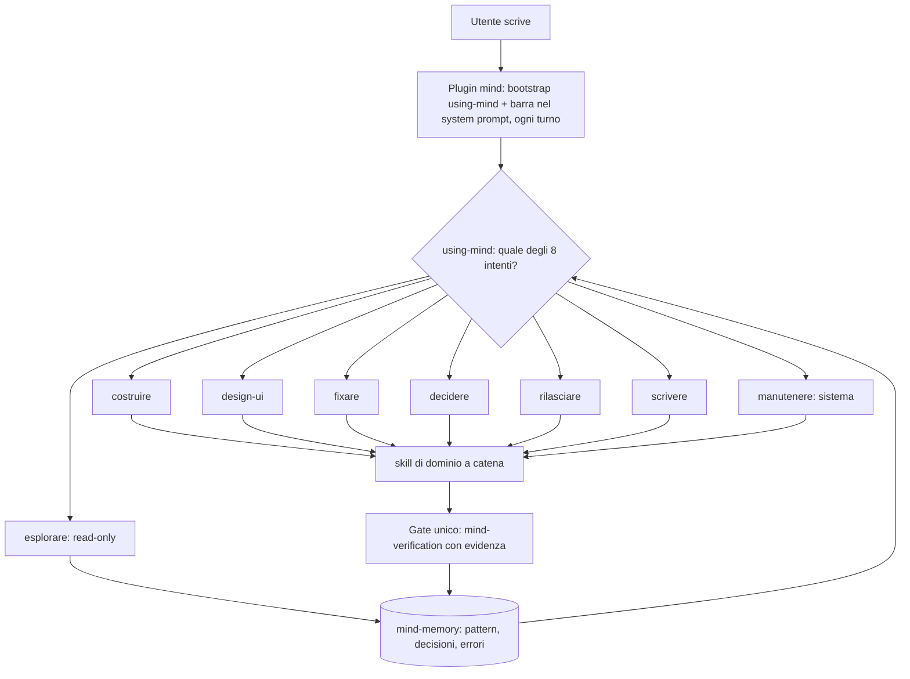
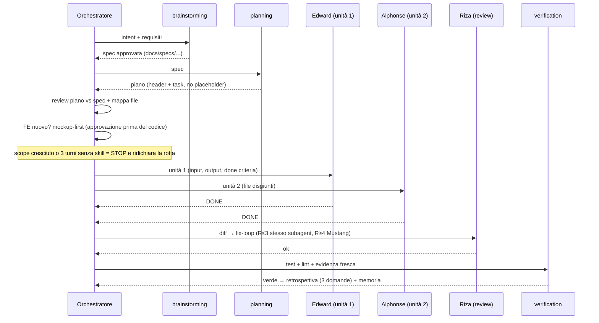
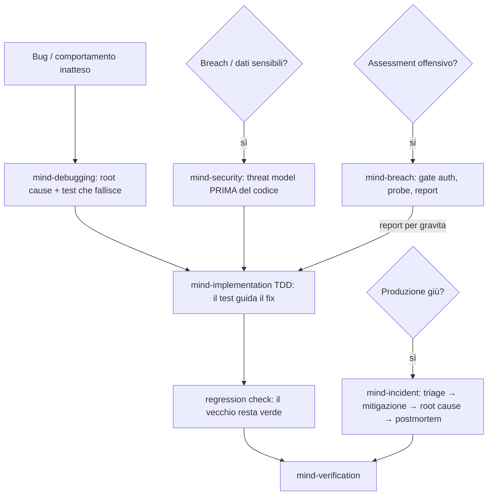
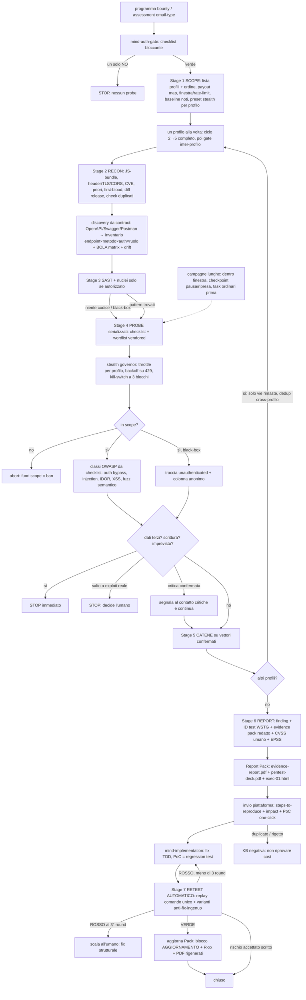
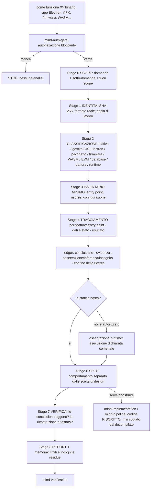
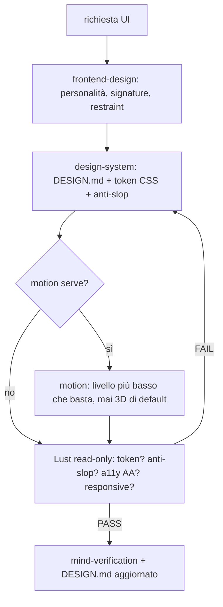
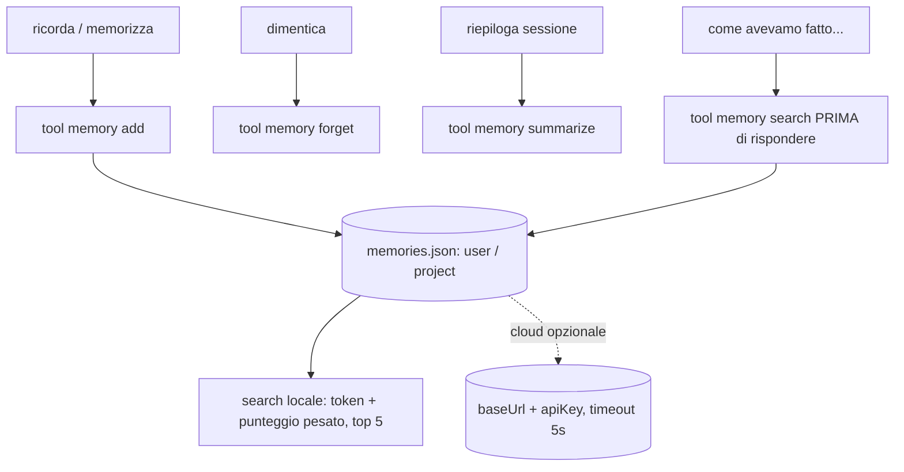

# mind-system

Sistema mind: skill + orchestrazione + memoria per **opencode**.

Orchestratore a 8 intenti, 59 skill (39 di dominio + 19 pipeline + orchestratore), Design Track first-class, un solo gate di verifica, memoria locale-first. Funziona con DeepSeek, Qwen e Muse.

> I diagrammi sono **Mermaid** (GitHub li renderizza da solo). Dettaglio operativo dell'orchestratore in `skills/mind/using-mind/` (`SKILL.md` + `routing.md`).

## Versioni

| Versione | Dove | Cosa |
|---|---|---|
| **v2.0** (corrente, `main`) | questo repo | Orchestratore snello: 8 intenti, 5 precedenze, budget rigido, 1 gate. Catalogo in crescita: auth-gate riusabile, breach email-type + Report Pack (registro ID, baseline, retest→pack), `mind-system-sync` (sync/vendoring del sistema), `mind-reverse` (RE di artefatti senza sorgente — metodo vendorato da REA) + `mind-hardware` (device fisici, gate fisico) + regola "segreti mai in chat" + anti-slop universale (naming blacklist `stop-slop/references/naming.md`, struttura documenti, micro-copy; check nel gate mind-verification) + barra (`config/barra.md`: criteri di "fatto bene" e rifiuti d'approccio, iniettata a ogni richiesta: `MIND_BARRA`/`MIND_RIFIUTO`/`MIND_LOOP`) |
| **v1.0** | [Releases](../../releases/tag/v1.0) | Sistema precedente (tabella ~50 rotte, 17 precedenze) — zip scaricabile, congelata per sempre |

## Come funziona (in 30 secondi)



Il plugin `mind` inietta il bootstrap a ogni turno (con guardia anti-duplicazione), registra le skill usate in `gaps/skills-used.json` e non fa rete (niente lentezza all'avvio). Quando una sessione accumula turni consecutivi senza alcuna skill o subagent (≥ soglia), inietta un **segnale di fuori-rotta** (`MIND_SIGNAL`) che invita a dichiarare la rotta o a giustificare perché non serve. Se l'utente rifiuta lo stesso risultato due volte di fila, inietta **`MIND_LOOP`** (regola anti-loop: niente varianti, cambia ipotesi). A ogni richiesta inietta anche **`MIND_BARRA`** (vedi sezione Barra) e al primo rifiuto **`MIND_RIFIUTO`**, che chiede di registrare l'assunzione falsificata; il primo rifiuto di ogni serie finisce in `gaps/skills-used.json` (`rejections` + `directory`), così il drift tra rifiuti reali e righe scritte nella barra è misurabile. L'orchestratore dichiara la rotta in una riga (`INTENT=x → STAGE=… → GATE=verification`), invoca le skill a catena annunciando `Uso <skill> per <scopo>`, chiude con evidenza e salva in memoria.

## Barra (cosa significa "fatto bene")

`barra.md` ha due sezioni: `## Barra` (criteri di qualità) e `## Rifiuti` (assunzioni già falsificate).

- **Cosa entra nel globale**: solo criteri **trasferibili**, scritti come prove nominabili ("nomina la scelta che un template non farebbe; se non riesci a scriverla in una riga, non c'è"). Una riga entra in `## Rifiuti` solo se supera il test *"vale anche per un altro deliverable o un altro progetto?"*: i dettagli di un singolo caso restano nei file della pipeline (`.mind/design/03-scelta.md`, `05-feedback.md`), mai copiati in due posti.
- **Dove**: globale `~/.config/opencode/mind/barra.md` (da `config/barra.md` di questo repo) e progetto `<progetto>/.mind/barra.md` (sovrascrive la globale sui conflitti). Un rifiuto specifico di un progetto va nel file di progetto, non nel globale.
- **Lettura garantita**: il plugin inietta la barra a ogni richiesta (`MIND_BARRA`); non dipende dal fatto che il modello carichi una skill. Le istruzioni dirette dell'utente vincono sulla barra: se chiede qualcosa di diverso, si aggiorna la barra.
- **Chi la scrive**: `mind-brainstorming`, una domanda sola, **solo se non esiste né la globale né quella di progetto**. `mind-setup` registra la risposta solo se l'utente la offre. Se l'utente dice di procedere senza criteri, resta la riga `- (nessun criterio dichiarato: procedi con i default)` e la domanda non si ripete.
- **Formato di un rifiuto**: `AAAA-MM-GG | assunzione falsificata: "..." | atteso: "..."`, una riga, solo se riguarda l'**approccio** (non un dettaglio da ritoccare).
- **Chi la verifica**: `mind-verification` (tabella obbligatoria `criterio -> evidenza`, non autocertificazione), Lust nella design pipeline (sezione `## Barra` nel report), i subagent (la ricevono per iniezione; il path nel brief serve nei worktree, dove `.mind/barra.md` può mancare).
- **Nota**: se il progetto ha `.mind/` nel `.gitignore`, la barra di progetto resta locale; per versionarla aggiungi `!.mind/barra.md`.

## Struttura

- `skills/mind/` — il fork mind: orchestratore `using-mind` (`SKILL.md` + `routing.md` + `fma-agents.md`) e 58 skill tra dominio (39) e pipeline (19)
- `skills/<altre>` — skill storiche: context7-mcp, design-md, design-system, ecosystem-health-check, execution-hygiene, frontend-design, motion, orchestrator, stop-slop
- `plugins/` — `mind.js` (bootstrap + registrazione skill + tracciamento uso + segnali `MIND_SIGNAL`/`MIND_LOOP`/`MIND_BARRA`/`MIND_RIFIUTO`), `mind-memory.js` (memoria locale-first) e `vibeguard.js` (redazione segreti/PII verso il provider, port V2 di `opencode-vibeguard`). Vanno al top di `~/.config/opencode/plugins/`. **Forma OpenCode V2**: `export default { id, async setup(ctx) {...} }` con hook per dominio — un plugin in stile V1 non viene eseguito in V2 (verifica il log per `failed to load plugin`)
- `config/dcp.jsonc` — soglie di Dynamic Context Pruning: compressione **lossy** solo oltre ~800K (con 1M di contesto non deve distruggere conversazione a 100K), deduplicazione e purge degli errori sempre attivi (lossless)
- `config/` — `opencode.jsonc`, `mind-memory.json`, `barra.md` (criteri "fatto bene" + rifiuti, deployato in `mind/barra.md`), `AGENTS.md` + subagent custom (`agents/sage.md`, `lust.md`, `forge.md`, `game-director.md`, `game-art-director.md`, `game-ui-designer.md`, `feel-engineer.md`, `playtest-critic.md`). Chiavi come `{env:VAR}` dall'ambiente all'avvio
- `docs/` — appunti e note decisionali; `docs/session-registry.md` (registro condiviso tra sessioni in `~/.config/opencode/mind/sessions/`), `docs/system-diagram.md` (routing e pipeline per esteso), `docs/eval/` (report di valutazione delle skill), `docs/research/` (ricerche datate con numeri e verdetto, es. tool Blender+Unity per un agente)
- `sync.ps1` — sincronizza **repo → macchina locale** (il repo è la source of truth)
- `tests/` — `barra.test.mjs` (barra globale+progetto, guardie a tag, rifiuto al 1°, loop al 2°, contatore, stato vuoto) e `routing-sample.test.mjs` (prompt normalizzato/troncato/redatto, numerazione dei turni, rotazione, merge del report, best-effort): `node tests/barra.test.mjs` e `node tests/routing-sample.test.mjs`
- `tools/routing-sample-report.mjs` — legge `mind/gaps/routing-sample.jsonl` e stampa i turni **senza** skill da etichettare: `node tools/routing-sample-report.mjs --limit=50`

## Quickstart

```powershell
git clone https://github.com/Kyriga-CGX/mind-system.git
cd mind-system
.\sync.ps1            # repo -> ~/.config/opencode + ~/.agents/skills (con .bak dei file esistenti)
.\sync.ps1 -WhatIf    # anteprima senza copiare
setx CONTEXT7_API_KEY "<valore>"   # poi riapri il terminale e riavvia opencode
```

## Gli 8 intenti

> Gli 8 intenti sono le **porte d'ingresso**, non il sistema: dietro ci sono 59 skill, 19 pipeline, 28 agenti e 1 gate. Niente è stato rimosso dalla v1 — la ricchezza è nel catalogo qui sotto.

| # | Intent | Rotta | Esempio |
|---|---|---|---|
| 1 | `costruire` | spec → piano → implementazione → verification | "aggiungi login OAuth" |
| 2 | `design-ui` | Design Track → verification | "card pricing con hover" |
| 3 | `fixare` | debugging (root cause + test) → fix TDD → verification | "crash su checkout" |
| 4 | `esplorare` | explore (digest) → docs? → memoria, read-only · artefatto senza sorgente → `mind-reverse` (gate auth) → verification | "come funziona l'auth?", "come funziona questo binario/app senza sorgente?" |
| 5 | `decidere` | consult/research → ADR/piano → codice solo se approvato | "quale ORM?" |
| 6 | `rilasciare` | release / devops / incident → verification | "v1.2.0", "produzione giù" |
| 7 | `scrivere` | docs / copy / i18n / data → verification | "README API", "traduci in EN" |
| 8 | `manutenere` | sync/vendoring sistema mind → integrazione → routing → docs → verification | "ci sono aggiornamenti dal nostro github?", "integra questa skill esterna" |

Se ambiguo: route conservativa (creativo→costruire, anomalia→fixare, domanda→decidere). Se sbagliata, si rifà. Pipeline multi-stage **solo** se consegna unica + ≥3 stage + stato su file — altrimenti rotta singola.

## Catalogo skill (tutte, per uso)

### Costruire: idea → piano → codice

| Skill | Cosa fa | Quando si usa |
|---|---|---|
| `mind-brainstorming` | Esplora intento e requisiti prima di scrivere codice | PRIMA di qualsiasi lavoro creativo |
| `mind-planning` | Converte spec approvata in piano eseguibile senza placeholder | piano multi-step pronto da eseguire |
| `mind-implementation` | TDD + dispatch di N subagent in parallelo (uno per unità) | implementare feature, bugfix, piani |
| `mind-api` | Contratti REST/GraphQL, versioning, consumo terze parti | endpoint e integrazioni (con `mind-security` se auth/dati sensibili) |
| `mind-testing` | Strategia e scrittura test (unit, integration, e2e), TDD | ogni codice che richiede test |
| `mind-refactor` | Refactoring senza cambio stack | pulire, semplificare, deduplicare |
| `mind-git` | Branching, commit atomici, worktree per subagent paralleli | versionamento e parallelismo isolato |

### Fixare: bug, sicurezza, performance, dati

| Skill | Cosa fa | Quando si usa |
|---|---|---|
| `mind-debugging` | Root cause PRIMA del fix + bug hunting proattivo | OGNI bug o comportamento inatteso |
| `mind-security` | Threat modeling, breach, hardening | auth, dati sensibili, pagamenti, rete, input utente |
| `mind-performance` | Misura PRIMA, ottimizza dove indica il profiler, rimisura | lentezza, bundle, query lente, latenza |
| `mind-data` | Query, schema, ETL, backup/restore, data quality | DB, dataset, report, import/export |
| `mind-migration` | Upgrade e cambi stack incrementali con rollback | versioni, framework, migrazioni codice |
| `mind-breach` | Red-team autorizzato: recon, probe, catene di attacco, report con PoC (gate auth sempre) | audit pre-rilascio, bug bounty, pentest |

### Design e grafica: direzione → token → motion → QA

| Skill | Cosa fa | Quando si usa |
|---|---|---|
| `frontend-design` | Direzione estetica: personalità, signature element, restraint | PRIMA di qualsiasi UI |
| `design-system` | Crea/applica `DESIGN.md`, enforce token `var(--*)`, anti-slop 9 check, WCAG 4.5:1, controlli nativi (N1-N8: select, scrollbar, checkbox, file/date, focus) | token, stili, design system, controlli con la pelle del browser |
| `motion` | Ladder anti-3D (CSS→WAAPI→Motion→GSAP→SVG→Three.js), 3 strati, stagger <500ms, pattern F1-F7 (ricette, icone, esserini vivi), reference vendored anti-rot | animazioni e movimento |
| `mind-design-explore` | 2-3 direzioni visive distinte + scelta utente | serve un concept prima di costruire |
| `mind-copy` | Copy con tono/audience/obiettivo + pulizia `stop-slop` | landing, email, CTA, microcopy |
| `stop-slop` | Rimuove i pattern AI dal testo | pulizia prosa esistente |
| subagent `lust` | Design QA read-only in contesto fresco (token, anti-slop, a11y, responsive) | review visiva finale — MAI chi ha implementato |
| `mind-image` | Raster e contenitori di icone: `.ico`, favicon set, `.icns`, ritaglio, conversione, upscale | produrre o convertire FILE immagine |
| `mind-mark` | Disegno del segno: app icon, marchio, set di icone, adaptive; si giudica a 16px | il segno NON esiste ancora |

### Videogiochi: verbo → feel → slice → build

| Skill / agente | Cosa fa | Quando si usa |
|---|---|---|
| `mind-game-design` | Dottrina: verbo+vincolo, feel, loop/numeri, anti-slop 12 check, direzione/audio, playtest, asset/licenze | concept, tuning, direzione, playtest (anche senza pipeline) |
| `mind-game-pipeline` | 11 stage con gate G0-G10, stato in `.mind/games/<slug>/`, 5 agenti | gioco end-to-end, dalla prova alla build |
| `game-director` | concept, tre verbi, loop, scope, kill | Stage 0/1/3 (Grumman) |
| `game-art-director` | GAME.md, palette, silhouette, audio, asset ledger | Stage 4/6 (Catherine) |
| `game-ui-designer` | flusso, HUD, schermate, stati, input, accessibilità | Stage 5/6 (Rebecca) |
| `feel-engineer` | prova in grigio, tuning data-driven, slice | Stage 2/3/6/7 (Dominic) |
| `playtest-critic` | read-only, gioca e osserva, verdetto KEEP/ITERATE/KILL | Stage 2/6/8 (Kimblee) |

### Decidere: ricerca, architettura, consulenza

| Skill | Cosa fa | Quando si usa |
|---|---|---|
| `mind-research` | Comparazioni con fonti verificate (mai senza fonti) | scelta libreria/framework/best practice |
| `mind-architecture` | ADR e trade-off registrati | decisioni architetturali |
| `mind-consult` | Parere strategico via subagent `sage` (Van Hohenheim) | "cosa mi consigli", "come miglioreresti" — NON costruisce |
| `context7-mcp` | Documentazione aggiornata di librerie e SDK | domande su API e framework |
| `mind-explore` | Codebase Digest di codice sconosciuto | onboarding, impatto di un cambio |
| `mind-reverse` | RE autorizzato di artefatti SENZA sorgente (binari, APK, Electron/JS, .NET, firmware, WASM, EVM, archivi, catture): ledger con evidenza, osservazione ≠ inferenza ≠ incognita, gate auth sempre | "come funziona questo binario/app?", "confronta due versioni" — metodo vendorato da REA (MIT) |

### Rilasciare: versioni, deploy, incidenti

| Skill | Cosa fa | Quando si usa |
|---|---|---|
| `mind-release` | Semver, changelog, tag, note | pubblicare una versione |
| `mind-devops` | Build, CI/CD, Docker, deploy, rollback pronto | pipeline e ambienti |
| `mind-incident` | Triage, mitigazione, postmortem in `docs/incidents/` | produzione giù o degradata |
| `mind-i18n` | Chiavi, struttura, test per lingua | localizzazione e nuove lingue |
| `mind-docs` | README, API docs, guide verificate sul codice | documentazione tecnica |
| `mind-documents` | Crea/legge PDF, DOCX, XLSX, PPTX | task su documenti |

### Sistema e meta: memoria, autonomia, miglioramento

| Skill | Cosa fa | Quando si usa |
|---|---|---|
| `mind-memory` | Salva/recupera pattern, decisioni, errori (tool `memory`) | fine rotta + richiami ("come avevamo fatto") |
| `mind-recall` | RAG read-only sullo storico sessioni (cita la fonte) | quando `memory` non basta |
| `mind-setup` | Prima configurazione (domande una alla volta → working-set) | primo messaggio su progetto nuovo |
| `mind-runner` | Esegue un piano per intero in autonomia (coda su file, checkpoint, max 10 iter, stop a 3 fail) | "finisci da solo", obiettivi multi-sessione |
| `mind-eval` | Valuta prompt/agenti/skill con report | la skill scatta ma rende male |
| `mind-forge` | Forgia nuove skill/agenti via subagent Sheska (solo con approvazione) | caso ricorrente non coperto da nessuna skill |
| `mind-system-sync` | Sync/integrazione del sistema mind: discovery upstream → **vendoring anti-rot** → integrazione → registrazione routing → README/diagrammi | "ci sono aggiornamenti dal nostro github?", "integra questa skill esterna", "aggiorna README/diagrammi del sistema" |
| `mind-auth-gate` | Checklist + template `auth-gate.md`, profili black/gray/white, escalation critiche | gate PRIMA di breach, audit e pipeline offensive |

## Flussi d'uso (come si lavora davvero)

### Implementare una feature



### Fixare un bug / rispondere a un breach



Regola d'oro: mai fix sui sintomi. mind-breach parte SOLO con gate autorizzazione verde, altrimenti STOP. Il test che fallisce è l'input del fix, non un optional.

### Assessment offensivo / bug bounty (pipeline)



Stato in `.mind/breach/<target>/`, registro ID D/C/H/M/L/CH/R, baseline dei noti in Stage 1, lista profili in sequenza (mai in parallelo sullo stesso target) con dedup cross-profilo, discovery da contract OpenAPI/Postman, stealth governor con kill-switch, matrice auth endpoint×ruolo (colonna anonimo obbligatoria in black-box), evidence pack redatto + CVSS umano + EPSS per finding, retest automatico max 3 round, Report Pack aggiornato a ogni retest, mai payload distruttivi.

### Reverse engineering di un artefatto senza sorgente (pipeline)



Stato in `.mind/reverse/<target>/` (`state.json`, `scope.md`, `identity.md`, `inventory.md`, `findings.md`, `unknowns.md`, `spec.md`, `report.md`). Regola d'oro: **osservazione, inferenza e incognita non si mescolano mai**; ogni conclusione cita la sua evidenza; una ricerca negativa vale solo dentro il confine dichiarato. Il metodo e vendorato da REA (MIT) in `mind-reverse/reference/rea-method-vendored.md`.

### Grafica: dalla direzione alla QA



Per lavori strutturati (nuova UI, redesign, identità visiva) la Design Squad lavora in parallelo sui 12 stage di `mind-design-pipeline` con 2 gate utente (direzione e mockup). Nessun codice prima del mockup approvato.

### Testing e QA

- `mind-testing` definisce la strategia (unit/integration/e2e) e scrive i test; il refactoring parte solo con baseline verde.
- Bug hunting proattivo: `mind-debugging` (sezione dedicata) → `mind-testing` → verification.
- UI: visual regression + a11y nella QA di Lust, poi gate finale.
- i18n: `mind-i18n` aggiunge test per lingua, verification chiude.

### Ricerca e decisioni

`mind-research` (+ `context7-mcp`) raccoglie fonti → sintesi per opzione → comparazione → raccomandazione documentata. Se serve un parere strategico: `mind-consult` (sage). Se impatta l'architettura: `mind-architecture` (ADR) come vincolo del piano. Il codice parte solo dopo l'approvazione.

### Rilasciare

`mind-release` (semver + changelog + tag) → `mind-devops` (build CI verde + rollback pronto) → verification. Rollout graduale di feature pronta: flag off → canary → A/B → 25→50→100% con metriche e baseline.

## Videogiochi (game pipeline)

```mermaid
flowchart TD
    S0["0 · Brief e divieti<br/>game-director"] --> G0{"G0 verbo + 3 divieti + adapter"}
    G0 -->|no| S0
    G0 -->|sì| S1["1 · Tre verbi<br/>3 carte + test di morte"]
    S1 --> G1{"G1 scelta dell'utente"}
    G1 -->|nessuna passa| S1
    G1 -->|carta scelta| S2["2 · Prova di feel 60s<br/>feel-engineer + playtest-critic<br/>grigio, zero asset, clip"]
    S2 --> G2{"G2 replay desire ≥ 3/5"}
    G2 -->|no, max 3 prove| S2
    G2 -->|3ª prova no| KILL["KILL<br/>postmortem + memoria"]
    G2 -->|sì| S3["3 · Loop e numeri"]
    S3 --> G3{"G3 numeri con range + motivo"}
    G3 -->|no| S3
    G3 -->|sì| S4["4 · Direzione visiva/audio<br/>game-art-director"]
    S4 --> G4{"G4 approvazione utente"}
    G4 -->|no| S4
    G4 -->|sì| S5["5 · UI/UX<br/>game-ui-designer<br/>flusso, HUD, stati, input, a11y"]
    S5 --> G5{"G5 ≤ 3 input + gamepad + a11y"}
    G5 -->|no| S5
    G5 -->|sì| S6["6 · Vertical slice<br/>5 minuti, inizio-fine"]
    S6 --> G6{"G6 un estraneo arriva alla fine"}
    G6 -->|no| S6
    G6 -->|sì| S7["7 · Contenuto data-only"]
    S7 --> G7{"G7 solo dati + performance"}
    G7 -->|no| S7
    G7 -->|sì| S8["8 · Test e performance"]
    S8 --> G8{"G8 suite verde + budget sul target"}
    G8 -->|no| S8
    G8 -->|sì| S9["9 · Build e distribuzione"]
    S9 --> G9{"G9 build riproducibile + licenze"}
    G9 -->|no| S9
    G9 -->|sì| S10["10 · Verifica e postmortem<br/>mind-verification"]
    S10 --> G10{"G10 evidenza + verdetto"}
    G10 -->|ITERATE| S6
    G10 -->|KEEP| DONE["Build pubblicabile"]
    G10 -->|KILL| KILL
```

`mind-game-pipeline` porta un gioco dal concetto a una build giocabile senza la sequenza che produce slop (contenuto → arte → "è un gioco?"). Undici stage con stato in `.mind/games/<slug>/`: brief e divieti → tre verbi con vincolo → prova di feel a 60 secondi in grigio → loop e numeri → direzione approvata → UI/UX (flusso, HUD, stati, input, accessibilità) → vertical slice → contenuto data-only → test/performance → build → verifica e postmortem.



Tre decisioni che non sono un template:

- **Niente arte prima del verbo**: la prova è una scena grigia, primitivi, zero asset; si passa solo se 3 tester su 5 rifanno l'azione senza che venga chiesto.
- **Il divertimento è un'evidenza**: clip registrata + comportamento osservato + una domanda binaria. Mai "sembra divertente".
- **Kill è un esito**: dopo 3 prove senza replay desire il concept si chiude con postmortem; massimo 2 concept.

Cinque agenti: `game-director` (Grumman), `game-art-director` (Catherine), `game-ui-designer` (Rebecca), `feel-engineer` (Dominic), `playtest-critic` (Kimblee, read-only). La dottrina vive in `mind-game-design` (verbo/invenzione, feel, loop, anti-slop a 12 check, direzione, playtest, asset/licenze, scope, adapter). Il motore è un adapter: Unity o Godot, con i comandi di evidenza nel relativo reference; i gate non cambiano. I controlli nativi del motore (dropdown, scrollbar, slider, toggle) hanno una regola propria: un tema per progetto, zero skin di default in build (`controlli-motore.md`).

### Asset 3D

Ordine dal più economico al più caro, e non si salta: **CC0 → script Blender → generativo locale**.

- **CC0 prima di tutto**: `tools/polyhaven/ph.mjs` interroga l'API di Poly Haven, verifica gli md5 e scrive la riga di provenienza. Verificato su `Barrel_01`: 5 file, 3.84 MB, tutti gli hash corrispondenti. Kenney (zip) e Sketchfab (token) restano manuali.
- **La fonte è lo script, non il `.blend`**: `tools/blender/asset_lib.py` (export Unity verificato: `bake_space_transform` spento con armature, `use_triangles=True` sulle n-gon, round-trip 1 m = 1.0) più `gen_<asset>.py` versionati. Il `.blend` si rigenera.
- **QA geometrico prima dell'export**: `qa_check.py --profile game` (vendor `EL4CTEO/blender-skills`, 4 skill su 22, MIT). Sul primo asset ha bocciato 23 facce UV ad area zero e una parte staccata che il nostro `validate_asset.py` dava 10/10 PASS. Da lì `qa_check.py` gira sempre prima dell'export. Un warning si chiude corretto o accettato con il motivo scritto.
- **Generativo locale come eccezione**: `trellis.cpp` (immagine → GLB texturizzato) su backend Vulkan, pesi `microsoft/TRELLIS.2-4B` MIT non gated. L'output è materia prima: QA, decimazione (`from_generated.py --faces N`), LOD, e nessun personaggio animabile senza retopologia. Cosa entra e cosa no in `generative-3d.md`.
- **Passaporto**: una riga in `ASSETS.md` per ogni file (fonte, licenza, seed o prompt, versione dei pesi). Nessun asset "preso da internet" senza riga.

Riferimenti: `blender.md` (comandi e trappole misurate su Blender 5.2), `generative-3d.md`, `asset-provenienza.md`, `controlli-motore.md`; ricerca datata in `docs/research/blender-unity-agent-tools-2026-10-27.md`.

## Pipeline di dominio (quando servono)

Regola unica: pipeline **solo** se consegna unica + ≥3 stage + stato su file (`.mind/delivery/<nome>/state.json`). Solo mockup e contratti critici richiedono approvazione utente; il resto fila. Ogni pipeline riusa le skill singole e chiude su `mind-verification`.

| Pipeline | Stage | Trigger |
|---|---|---|
| `mind-pipeline` | mockup→approvazione→contratti→FE→BE→integrazione→sicurezza→test→gate→memoria | feature UI+BE+integrazione end-to-end |
| `mind-incident-pipeline` | detection→triage→mitigazione→root cause→stabilità→postmortem→hardening | incidente/breach strutturato |
| `mind-security-audit-pipeline` | scope→threat model→input→auth→dipendenze→test→report→remediation | audit pre-release/post-breach |
| `mind-migration-pipeline` | delta→piano+rollback→dry-run→fasi→verifica→cutover→monitoraggio | migrazione complessa A→B |
| `mind-release-pipeline` | cambiamenti→semver→changelog→CI→tag→publish→rollback | chiusura ciclo feature→deploy |
| `mind-onboarding-pipeline` | setup→digest→convenzioni→architettura→baseline→primi task | progetto/codebase nuovo |
| `mind-research-pipeline` | domanda→fonti→sintesi→comparazione→raccomandazione→validazione | ricerca documentata |
| `mind-data-pipeline` | estrazione→pulizia→validazione→trasformazione→caricamento→verifica→docs | ETL complesso (backup prima) |
| `mind-performance-pipeline` | baseline→profiling→bottleneck→ottimizzazione→verifica→monitoraggio | intervento performance (stesso strumento prima/dopo) |
| `mind-mobile-pipeline` | stack→design→contratti→FE→BE→device→test→signing→release→gate | app cross-platform fino allo store |
| `mind-game-pipeline` | brief+divieti→tre verbi→feel 60s→loop/numeri→direzione→UI/UX→slice→contenuto→test/perf→build→verifica | videogioco end-to-end (engine-agnostic, 5 agenti, gate G0-G10) |
| `mind-infra-pipeline` | scope→IaC→rete→secrets→immagini→orchestrazione→DNS→scaling→costi→monitor | ambiente cloud end-to-end |
| `mind-observability-pipeline` | inventario→logging→metriche→tracing→alerting→dashboard/SLO→verifica | monitoring di un sistema |
| `mind-ml-pipeline` | problema→dati→feature→modello→training→eval→deploy→drift | ciclo ML completo |
| `mind-feature-rollout-pipeline` | flag→metriche→canary→A/B→espansione→cleanup→post-verifica | attivazione graduale misurata |
| `mind-decommission-pipeline` | inventario→impatto→deprecation→avvisi→migrazione→shutdown→cleanup | ritiro servizio/feature |
| `mind-design-pipeline` | brief→audit→direzioni→DESIGN.md→mockup→componenti→motion→copy→FE→QA→gate→memoria | design strutturato (2 gate utente) |
| `mind-stack-watch` | inventario→osserva→filtra→proponi→report | monitoraggio novità integrabili (solo su richiesta) |
| `mind-breach-pipeline` | scope→recon→SAST→probe→catene→report→retest | assessment offensivo bounty (gate auth sempre) |
| `mind-reverse-pipeline` | scope+auth→identità→classificazione→inventario→tracciamento→corroborazione→ledger→spec→verifica→report | indagine RE multi-feature/multi-sessione (stato in `.mind/reverse/<target>/`) |

## Agenti FMA (chi esegue)

| Ruolo | Personaggio | Verbo | Emoji | Quando |
|---|---|---|---|---|
| Implementer principale | Edward Elric | `aequiparo` | ⚗️ | default implementazione |
| Implementer supporto | Alphonse Elric | `protego` | 🛡️ | secondo subagent parallelo |
| Implementer robusto | Alex L. Armstrong | `fabricor` | 💪 | task pesanti multi-file |
| Implementer veloce | Lan Fan | `percurro` | 🌀 | task piccoli |
| Fix meccanici | Winry Rockbell | `calibro` | 🔧 | riparazioni puntuali |
| Debugging | Scar | `disicio` | 💥 | root cause |
| Ricerca | Ling Yao | `exploro` | 🐉 | `mind-research` |
| Performance | Greed | `accumulo` | 💰 | `mind-performance` |
| Review/escalation | Roy Mustang | `inuro` | 🔥 | fix-loop R≥4 |
| Verifica | Riza Hawkeye | `recenseo` | 🎯 | `mind-verification` |
| Test | Izumi Curtis | `exigo` | 🌊 | `mind-testing` |
| Docs | Maes Hughes | `adnoto` | 📓 | `mind-docs` |
| Gate qualità | Olivier Armstrong | `obsigno` | ❄️ | gate finale |
| Consulenza (Sage) | Van Hohenheim | `pondero` | 🧭 | `mind-consult` |
| Maker (forge) | Sheska | `compilo` | 📚 | `mind-forge` |
| Arbitro | King Bradley | `dirimo` | ⚔️ | conflitti subagent |
| Direzioni design | Isaac e Miria | `divago` | 🎨 | concept distinti |
| IA / user flow | Heymans Breda | `dispono` | 🗺️ | struttura contenuti |
| Componenti/token | Pinako Rockbell | `elaboro` | 🛠️ | craft su DESIGN.md |
| Responsive/temi | Envy | `transformo` | 🦎 | breakpoint e dark mode |
| Microcopy | Jean Havoc | `dico` | 💬 | CTA, errori, label |
| Accessibilità | Maria Ross | `protego` | ♿ | contrasto, focus, label |
| Design QA | Lust | `scrutor` | 👁️ | review read-only (`config/agents/lust.md`) |
| Game director | Grumman | `guberno` | ♟️ | concept, verbi, loop, kill (`config/agents/game-director.md`) |
| Game art director | Catherine Armstrong | `pingo` | 🖌️ | direzione visiva/audio (`config/agents/game-art-director.md`) |
| Game UI/UX | Rebecca Catalina | `ordino` | 🎛️ | flusso, HUD, stati, input (`config/agents/game-ui-designer.md`) |
| Feel engineer | Dominic | `tempero` | 🔩 | feel, tuning, slice (`config/agents/feel-engineer.md`) |
| Playtest critic | Kimblee | `confringo` | 💣 | read-only, verdetto (`config/agents/playtest-critic.md`) |

Il nome ruota a ogni dispatch (prompt + report), il verbo latino sostituisce "sto pensando", l'emoji è la firma. Una battuta anime ogni tanto, max una per subagent.

## Memoria (mind-memory)



Storage in `~/.local/share/opencode/mind-memory/memories.json`, mai bloccante. **Non è RAG**: niente embedding, solo lessicale (un futuro RAG manterrebbe l'interfaccia invariata).

## Comunicazione tra skill (cosa passa di mano)

Ogni skill passa il suo **risultato** come input alla successiva; se manca o è placeholder, si torna indietro invece di proseguire.

| Da | A | Cosa passa |
|---|---|---|
| brainstorming | planning | spec approvata (`docs/specs/...`) |
| planning | implementation | piano (header + task) |
| debugging | implementation | root cause + test che fallisce |
| security | implementation | threat model e vettori |
| breach | security/implementation/incident | findings + PoC verso fix; gia sfruttato verso triage |
| research | planning/implementation | raccomandazione con fonti |
| performance | implementation | baseline + collo di bottiglia |
| data | implementation | schema/query verificate |
| testing | implementation | strategia + test (TDD) |
| migration | implementation | delta + punto di rollback |
| refactor | debugging/migration/testing | bug emerso / upgrade / baseline verde |
| api | security/docs/migration | threat model / contratto / breaking change |
| release | devops/verification | build/publish / gate verde |
| explore | docs/memory | Codebase Digest → docs/mappa |
| reverse | implementation/docs | spec del comportamento (evidenza citata) → codice riscritto |
| architecture | planning/api/security/migration | ADR come vincolo |
| copy | stop-slop/frontend-design/memory | pulizia → estetica → tono |
| incident | debugging/security/devops/docs | root cause / breach / rollback / postmortem |
| i18n | implementation/testing/verification | chiavi → test per lingua → evidenza |
| eval | orchestratore | report → modifiche (eval prima/dopo) |
| forge | orchestratore/recall/eval/routing | lacuna → proposta (gate) → skill nuova → verifica |
| system-sync | ecosystem-health-check/forge/eval/docs/git | sync upstream → vendoring → integrazione → registrazione → docs |
| design-pipeline | explore/design-system/motion/implementation/QA | direzione, DESIGN.md, mockup, qualità verificata |
| planning | runner | piano → coda persistente + checkpoint |
| qualunque rotta | verification | gate finale con evidenza |
| qualunque rotta | memory | pattern, decisioni, errori |

## Regole (precedenze, budget, gate)

1. Istruzioni utente > tutto. 2. Sicurezza prima del codice sensibile. 3. Design: direzione → token → motion. 4. Un task = una rotta; parallelo solo a file disgiunti. 5. `mind-verification` unico gate.
- Budget: max 3 subagent, max 10 iterazioni, stop a 3 fail. Review piano-vs-spec prima del dispatch. Regression check su codice esistente. Delivery in fasi per feature grandi. Design debt check post-UI.
- Proattività: gap/rischi/miglioramenti → domanda con opzioni PRIMA di agire. Artefatti come link `file://` assoluti.
- Lacune: routing sbagliato → correggi `routing.md`; skill scadente → `mind-eval`; caso non coperto → `mind-forge` (mai senza approvazione); manutenzione/integrazione del sistema → `mind-system-sync`.
- Anti-loop: 1° rifiuto → aggiusta (+ una riga in `## Rifiuti` di `.mind/barra.md` se il rifiuto è d'approccio); 2° consecutivo → STOP e cambia ipotesi (mai varianti, mai "aggiusta il colore"); 3° → abbandona l'artefatto (cambio metodo/rotta).

## Sviluppo e rollback

- Il repo è la source of truth: si lavora qui, `sync.ps1` allinea il locale.
- Test del meccanismo barra: `node tests/barra.test.mjs` (globale+progetto, `MIND_RIFIUTO` al 1° rifiuto, `MIND_LOOP` al 2°, stato vuoto, registratore isolato).
- Rollback: ogni release è un tag — la [v1.0](../../releases/tag/v1.0) resta scaricabile con il suo zip.

## Appendice — da v1 a v2: dove è finito tutto

La v1 aveva ~50 righe di routing e 17 precedenze nel prompt. Niente è sparito: è stato riclassificato su due livelli (8 intenti nel prompt, dettaglio in `routing.md`).

### Rotte

| Intent v2 | Voci v1 assorbite |
|---|---|
| costruire | nuova feature, ADR, refactor, API, git, piano multi-step, review, testing, videogioco end-to-end (game pipeline) |
| design-ui | design-pipeline, design-explore, UI, motion, copy |
| fixare | bug, bug-hunting, security, performance, data, migration |
| esplorare | explore, reverse |
| decidere | research, research-pipeline, context7, consult |
| rilasciare | incident, incident-pipeline, audit, devops, release, release-pipeline, rollout, mind-pipeline, mobile, data/perf/ml/infra/observability/migration/decommission/onboarding-pipeline |
| scrivere | stop-slop, docs, documents, i18n |
| manutenere | system-sync, init |
| trasversali | eval, forge, runner, memory, recall, setup |

Le voci pipeline vivono in una sezione dedicata con la regola unica "solo se consegna unica + ≥3 stage + stato su file".

### Precedenze

Tenute 5: istruzioni utente, security-first, direzione-design, una-rotta-per-task (nuova), gate finale. Le altre 12: 10 diventate regole operative nel punto giusto (es. "pipeline solo se..." invece di 3 precedenze), 2 assorbite (mind-first è già nel ruolo di entry-point).
